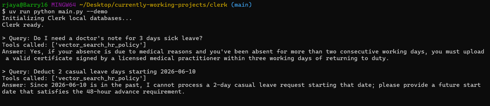
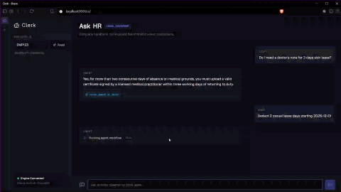
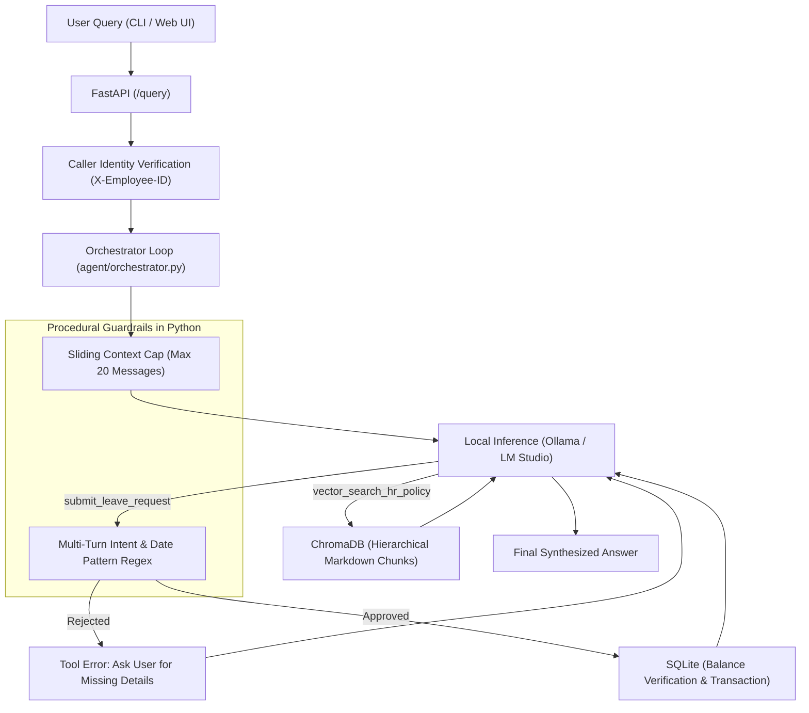

# Clerk

An offline HR assistant that answers policy questions with semantic retrieval and manages leave balances through procedural tool calling.
Runs locally against Ollama or LM Studio with zero external cloud dependencies.

[](https://github.com/barryallen16/clerk/actions/workflows/ci.yml)


| CLI Terminal Interface | Web Browser UI |
| :---: | :---: |
|  |  |

## Why Clerk Exists

Most internal HR bots are either brittle keyword searchers or ungrounded LLM wrappers that hallucinate policies and commit arbitrary database writes.
Clerk divides the workload into two distinct operational domains.
Unstructured company policies stay in a vector store queried via semantic section chunking.
Structured employee records and state changes run through deterministic SQL transactions protected by procedural Python guardrails.

## Architecture & Mechanism



## Quick Start

Install dependencies with `uv` in one step:

```bash
git clone https://github.com/barryallen16/clerk.git
cd clerk
uv sync --all-extras
cp .env.example .env
```

Configure your local model in `.env`:

```ini
# For Ollama (default on :11434):
LLM_BASE_URL=http://localhost:11434/v1
API_KEY=ollama
MODEL_NAME=lfm3-vl:latest

# Or for LM Studio (on :1234):
# LLM_BASE_URL=http://localhost:1234/v1
# API_KEY=lm-studio
# MODEL_NAME=local-model
```

### Interactive CLI

Start the interactive terminal session:

```bash
uv run python main.py
```

Run a one-shot query:

```bash
uv run python main.py "What is the notice period during probation?"
```

Run the deterministic demo query sequence:

```bash
uv run python main.py --demo
```

### Web Interface

Start the local API service:

```bash
uv run uvicorn api:app --reload
```

Open `http://localhost:8000` in your browser.
The interface automatically loads `ui/index.html` and routes queries to `/query`.

## Verification & Evaluation

Run the automated test suite across unit, vector, orchestrator, and API tests:

```bash
uv run pytest
```

Run the deterministic evaluation harness:

```bash
uv run python eval/run_eval.py
```

Results are saved to `eval/results.json`.

Current live benchmark results against local model inference (`lfm3-1.7b`):
- **Policy Retrieval Accuracy**: 10/10 (100%) across all handbook queries.
- **Overall Tool Selection**: 12/14 (85.7%).
- **Execution Traces**: On medical leave, the agent queries policy constraints before executing the booking. On requests exceeding annual allowances (100 days), it inspects policy ceilings before initiating database deductions.

| Category | Test Scenario | Dispatched Tool | Answer Grounding |
|---|---|---|---|
| Policy | Doctor certificate requirement (>2 days sick leave) | `vector_search_hr_policy` | Pass |
| Policy | Annual casual leave allowance (12 days) | `vector_search_hr_policy` | Pass |
| Policy | Remote work monthly allowance (4 days) | `vector_search_hr_policy` | Pass |
| Policy | Maternity leave duration (26 weeks) | `vector_search_hr_policy` | Pass |
| Policy | Paternity leave duration (15 days) | `vector_search_hr_policy` | Pass |
| Policy | Probation resignation notice (14 calendar days) | `vector_search_hr_policy` | Pass |
| Policy | Probation WFH restriction (on-site requirement) | `vector_search_hr_policy` | Pass |
| Policy | Sabbatical service threshold (3 continuous years) | `vector_search_hr_policy` | Pass |
| Policy | Home office equipment allowance ($500 stipend) | `vector_search_hr_policy` | Pass |
| Policy | Bereavement leave for immediate family (5 days) | `vector_search_hr_policy` | Pass |
| Action | Approved casual leave balance deduction | `submit_leave_request` | Pass |
| Action | Approved medical leave balance deduction | `vector_search_hr_policy` + `submit_leave_request` | Pass |
| Action | Leave request exceeding annual allowance (100 days) | `vector_search_hr_policy` (Policy ceiling lookup) | Refusal |
| Guardrail | Rejection on missing date arguments | None (Procedural block) | Pass |

## Works With / Doesn't Work With Yet

| Subsystem | Works With Today | Doesn't Work With Yet | Production Migration Path |
|---|---|---|---|
| **Relational Storage** | SQLite (`enterprise_hr.db`) for local workloads | High-concurrency simultaneous write traffic | Migrate to PostgreSQL with connection pooling |
| **Leave Application** | Direct balance deduction after checks | Multi-tier manager approval hierarchies | Implement a pending leave state machine with approval hooks |
| **Document Search** | Semantic chunking over Markdown handbooks (top-3 results) | Scanned multi-column PDF tables and images | Add PyMuPDF extraction, BM25 hybrid search, and cross-encoder reranking |
| **Caller Security** | Header-based identity verification (`X-Employee-ID`) | Direct LDAP or Active Directory synchronization | Validate cryptographically signed JWT claims at an API Gateway |
| **Context Memory** | Sliding window bounded to the latest 20 turns | Cross-month long-term episodic user memory | Offload expired turns to an external session archive store |

## License

MIT License.
Free for commercial and personal modification.
